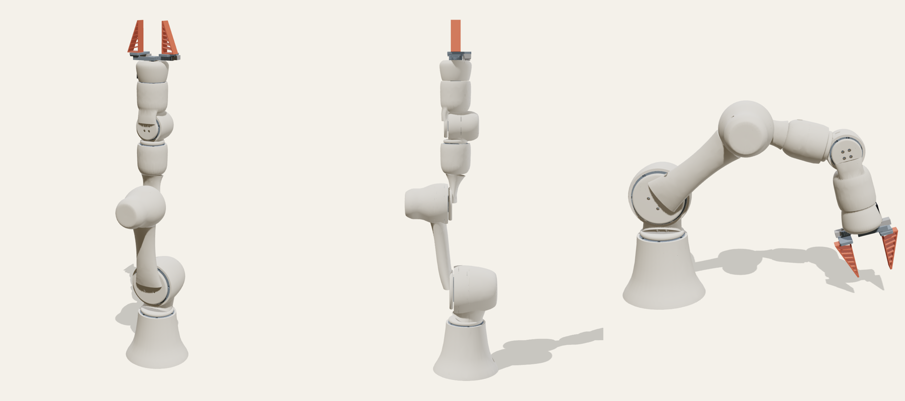
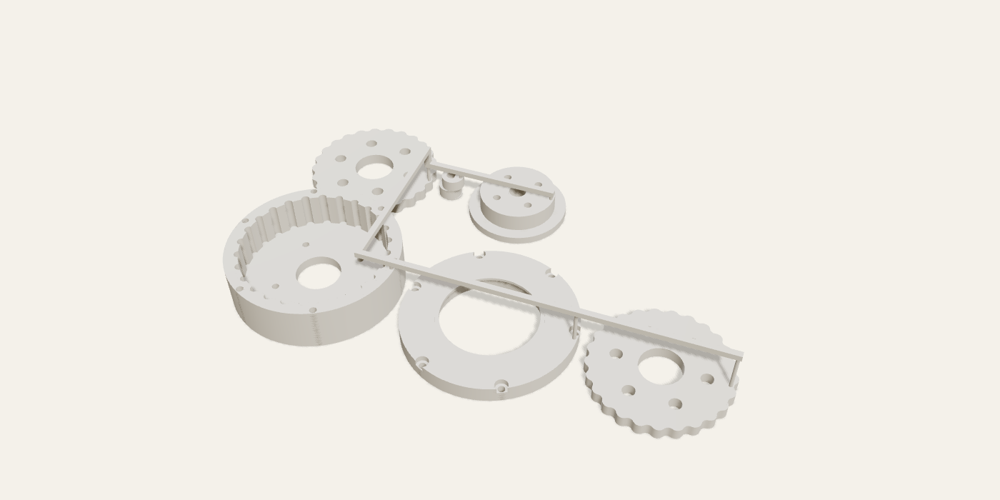

# GRIP

An open-source, fully printed 6-axis robot arm. The structure is SLS nylon with soft, organic shells. Every joint is a closed-loop stepper driving a printed cycloidal gearbox, and the fingers are TPU fin-ray. Parts cost is about $900. Its first target job is unloading a 3D printer: pulling the flex plate, popping parts off, and putting the plate back.



> **Status: v0.2 CAD.** The geometry builds, the gearboxes mesh without interference, every printed part exports, and the CAD checks that each motor and its driver board fit inside their link, that the joints clear each other through their ranges, and that every hub bolt can be reached with a hex driver. Nothing has been printed or assembled yet. The [build guide](docs/BUILD.md) is a first draft. Vendor dimensions marked `VERIFY` in `cad/grip_cad/params.py` are catalogue values to check against the parts you buy.

## Spec (version B)

| | |
| --- | --- |
| Axes | 6 + parallel gripper |
| Reach | 500 mm (upper arm 187, forearm 185, wrist 128) |
| Payload | 0.5 kg continuous, 1 kg peak |
| J1 base, J3 elbow | NEMA 17 60 mm + 25:1 SLS cycloidal |
| J2 shoulder | NEMA 23 56 mm + 30:1 SLS cycloidal |
| J4–J6 wrist | NEMA 17 34 mm pancake + 15:1 SLS cycloidal |
| Gripper | Feetech STS3215, rack and pinion on an MGN7 rail, 0–80 mm opening, TPU fin-ray fingers |
| Drivers | MKS SERVO42D / SERVO57D (CAN), one bus |
| Power | 24 V |
| Structure | SLS PA12, PA12-GF for loaded parts, TPU fingers |

The full design rationale, the torque budget and the three alternative versions (all-servo ~$350, lite QDD ~$1,300, full QDD ~$2,200) are in the spec document.

## Repository

```
cad/
  grip_cad/params.py      every driving dimension: joints, gearboxes, vendor parts
  grip_cad/cycloidal.py   parametric two-disc cycloidal reducer
  grip_cad/shapes.py      organic primitives: revolved pods, lofted bones, soft seams
  grip_cad/arm.py         link shells and joint placement
  grip_cad/gripper.py     gripper, involute pinion, racks, fin-ray fingers
  grip_cad/assembly.py    posable assembly (forward kinematics)
  build.py                build everything -> exports/
  preview.py              render PNG previews in any pose
  drawings.py             technical drawings (SVG) for the build guide
  exploded.py             exploded gearbox renders
  render3d/               headless three.js renderer used by preview.py
exports/
  step/                   one STEP per printed part + grip_assembly.step
  stl/                    one STL per printed part
  stl/kits/               the small parts stacked into compact snap-off towers, for print bureaus
  printed_parts.csv       part, quantity, material, volume, bounding box
  service_kits.csv        the same for the stacked kits
bom/
  bom.csv                 bought parts: spec, quantity, price, where to buy
  BOM.md                  the same as a readable table (python bom/make_bom.py)
docs/BUILD.md             build guide
docs/drawings/            technical drawings (python drawings.py)
docs/img/                 renders (python preview.py, python exploded.py)
```

## Building the CAD

```bash
cd cad
python -m venv .venv && . .venv/bin/activate
pip install -r requirements.txt
python build.py                      # writes ../exports
# previews need Node + Playwright with Chromium
(cd render3d && npm install)
python preview.py /tmp/grip --pose 30,50,55,0,60,0
```

Change a number in `params.py` and rebuild. Socket sizes, bolt patterns and pod shapes all follow from it.

## Printing

All shells are hollow with 2 mm walls. Every link has at least two cable ports, which also serve as powder escape holes. `build.py` refuses to export any part that isn't a single closed, manifold body.

There are two ways to print:

- **Your own SLS machine:** print the individual files in `exports/stl/`.
- **A print bureau:** bureaus charge a minimum of about $11 per part, however small. Bureaus also price a part by its bounding box. So the 36 small gearbox and gripper parts are stacked into compact towers in `exports/stl/kits/`, with 2 mm air gaps and 1.6 mm pillars between neighbours. That makes the order 15 pieces instead of 50, and the stacked boxes are 40–60% smaller than flat sprue trees. Snip the pillars and file the nubs flush. They sit on flat faces near the outer edge, away from bores, lobes and bearing seats.

| Order for a bureau | Qty | Material |
| --- | --- | --- |
| base, turret, upper_arm, forearm, wrist_yoke, wrist_link, gripper_palm | 1 each | SLS PA12 |
| kit_j2_drive | 1 | SLS PA12 |
| kit_j1_j3_drive | 2 | SLS PA12 |
| kit_wrist_drive | 3 | SLS PA12 |
| kit_gripper | 1 | SLS PA12 |
| kit_fingers | 1 | SLS TPU 90A–95A |

Total printed volume is about 1,600 cm³.



## How a joint works

Each joint is the same parametric module in three sizes. A stepper turns a two-lobe eccentric, which drives two cycloidal discs, 180° out of phase, around a ring of steel dowel pins. Output pins carry the slow rotation to a flange that runs in a thin-section bearing. The housing drops into a socket in the parent link and is held by six M3 screws into heat-set inserts. The child link's hub bolts to the output flange.

| Drive | Ring pins | Ratio | Housing OD | Output bearing |
| --- | --- | --- | --- | --- |
| J2 | 31 x Ø4 mm | 30:1 | 102 mm | 6812 |
| J1, J3 | 26 x Ø4 mm | 25:1 | 86 mm | 6808 |
| J4–J6 | 16 x Ø3 mm | 15:1 | 62 mm | 6805 |

## Roadmap

- [x] Concept CAD, all parts exporting
- [x] Printability fixes (single manifold bodies, powder escape)
- [x] Cost pass 1: thinner walls, lighter sockets, stacked kits (50 pieces down to 15, kit boxes 40–60% smaller)
- [ ] Cost pass 2: bureau re-quote, cheaper bought parts
- [x] Build guide with technical drawings: [docs/BUILD.md](docs/BUILD.md) (first draft; nobody has built one yet)
- [ ] BOM with purchase links (draft in [bom/BOM.md](bom/BOM.md), bought parts about $590, some prices still estimates)
- [ ] First print and gearbox bench test
- [ ] URDF, ROS 2 / MoveIt 2 and LeRobot drivers

## License

Hardware: [CERN-OHL-W-2.0](LICENSE).
