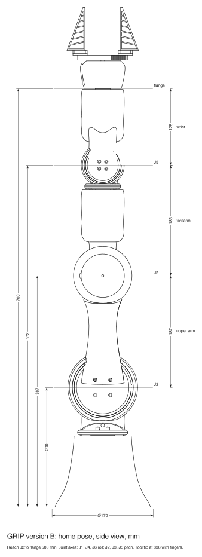
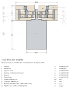
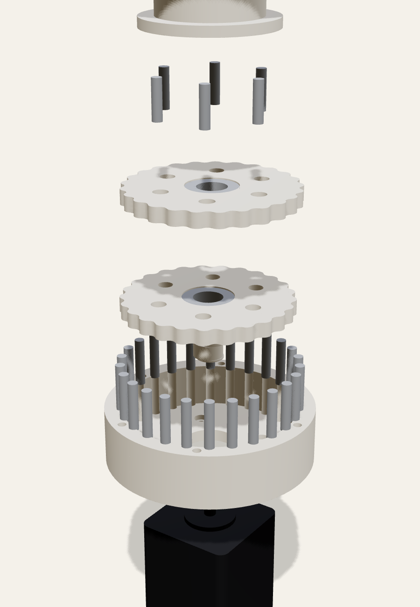
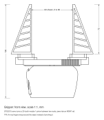

# GRIP build guide (version B)

This guide takes you from a box of printed parts and a pile of bought parts to an arm that moves on the CAN bus. Plan on a weekend: about 3 hours for the six gearboxes, 3 hours for the arm and gripper, and 2 hours for wiring and setup.

> **Status:** written from the v0.1 CAD. Nobody has built one yet, so expect to adjust fits. Please open an issue with anything that didn't work, along with the fix you used.

All drawings are generated from the same CAD as the exports (`python cad/drawings.py`), so they match the files you print.

## Contents

1. [What you need](#1-what-you-need)
2. [Prepare the printed parts](#2-prepare-the-printed-parts)
3. [Build the six gearboxes](#3-build-the-six-gearboxes)
4. [Assemble the arm](#4-assemble-the-arm)
5. [Build the gripper](#5-build-the-gripper)
6. [Wiring](#6-wiring)
7. [Driver setup and first motion](#7-driver-setup-and-first-motion)
8. [Joint limits](#8-joint-limits)

## 1. What you need

**Printed parts.** Order them as listed in the [README](../README.md#printing): seven link and palm shells, plus five stacked kits for a bureau, or print the individual files in `exports/stl/` yourself.

**Bought parts.** These are in [bom/BOM.md](../bom/BOM.md). They come to about $600, and most of that is the six steppers and their closed-loop drivers.

**Tools:**

- Soldering iron with a heat-set insert tip (or a plain conical tip at about 220 °C)
- Hex keys or drivers: 1.5, 2, 2.5, 3 and 4 mm. You also need a **ball-end 2.5 mm driver at least 150 mm long** for the J1 and J4 hub bolts.
- Flush cutters and a needle file, for the kit pillars
- A bench vise or small arbor press with soft jaws, for pins and bearings
- Digital calipers
- Drill bits 3.0, 4.0 and 5.0 mm, to clean pin holes by hand if they print tight
- PTFE or lithium grease
- Medium threadlocker (Loctite 243)
- A multimeter

**Fasteners at a glance:**

| Where | Fastener | Qty |
| --- | --- | ---: |
| Motor to gearbox housing, NEMA 17 | M3x8 low-head (DIN 7984) | 20 |
| Motor to gearbox housing, NEMA 23 | M5x16 low-head + M5 nyloc nut | 4 |
| Gearbox into its socket, J2 | M3x40 socket head | 6 |
| Gearbox into its socket, J1 and J3 | M3x35 socket head | 12 |
| Gearbox into its socket, J4 to J6 | M3x30 socket head | 18 |
| Child hub to output flange (all six joints, including the palm on J6) | M3x8 socket head | 24 |
| Heat-set inserts, sockets and output flanges | M3 x 5.7 brass | 60 |
| Base to table | M5 heat-set insert + M5x20 | 3 |
| MGN7 rail to palm, carriages to jaws | M2x8 | 12 |
| Fingers to jaws | M3x16 + M3 nyloc nut | 4 |

## 2. Prepare the printed parts

1. **Depowder** everything, ideally by bead blasting. The links have at least two cable ports each, so blow air through them until nothing more comes out.
2. **Break out the kits.** Clip each pillar close to the part with flush cutters, then file the nub flush. The nubs are on flat faces near the outer edge, so they never sit on a bearing seat or a lobe. Keep each gearbox's six parts together. Disc A and disc B look alike but are **not interchangeable**: B's holes are clocked half a lobe from A's.
3. **Check the pin holes.** A dowel should press in with the vise and stay put. If one won't start, run the matching drill bit through by hand. Don't use a power drill, which opens the hole too far.
4. **Check the bearing seats.** The output bearing should press into the cap with firm thumb pressure or the vise. The eccentric bearings should press into the discs the same way. If a seat is loose, a drop of threadlocker on the outer ring holds it.
5. **Set the heat-set inserts**, pressing straight and flush:
   - six M3 inserts in the ledge of every gearbox socket (base, turret, upper arm, forearm, wrist yoke, wrist link)
   - four M3 inserts in the face of each output flange
   - three M5 inserts in the bosses under the base

## 3. Build the six gearboxes

There are three sizes of one design. Build all six before starting on the arm, and bench test each one.

| Joint | Gearbox | Motor | Drawing |
| --- | --- | --- | --- |
| J1 base | 25:1, Ø86 | NEMA 17, 60 mm | [drive_j1_j3.svg](drawings/drive_j1_j3.svg) |
| J2 shoulder | 30:1, Ø102 | NEMA 23, 56 mm | [drive_j2.svg](drawings/drive_j2.svg) |
| J3 elbow | 25:1, Ø86 | NEMA 17, 60 mm | [drive_j1_j3.svg](drawings/drive_j1_j3.svg) |
| J4, J5, J6 wrist | 15:1, Ø62 | NEMA 17, 34 mm | [drive_wrist.svg](drawings/drive_wrist.svg) |

The numbers in the steps below refer to the balloons in the section drawings. The exploded view shows the same order from the bottom up.

1. **Ring pins (7) into the housing (1).** Press each dowel down until it bottoms out. Its top should sit flush with the housing's top face. A flat bar across the housing helps you press several at once.
2. **Motor (10) onto the housing.** Seat the motor's centring boss in the hole in the housing floor, with the motor leads pointing where the cable will exit the link (see section 4). Fasten it from inside the housing with the low-head screws, which drop into counterbores so their heads sit below the discs. Use threadlocker.
   - NEMA 17: M3x8 straight into the motor's threaded holes.
   - NEMA 23: the flange holes are plain, so use M5x16 with a nyloc nut behind the flange.
3. **Eccentric (5) onto the motor shaft.** Line up the key with the shaft's flat and push it down until the collar touches the floor. Then lift it about 0.3 mm (a sheet of paper) so it doesn't rub.
4. **Bearings (9) into the discs (3, 4).** Press one small eccentric bearing into the centre of each disc.
5. **Disc B (4) first, then disc A (3).** Grease the ring pins and disc edges lightly. Slide disc B over the lower eccentric lobe, turning it until its lobes drop between the pins. Then slide disc A over the upper lobe. The two discs end up offset in opposite directions.
6. **Output pins (8) into the output flange (6).** Press them into the blind sockets in the flange's underside.
7. **Flange onto the discs.** Lower the flange so its pins pass through the round holes in both discs. Turn the motor shaft by hand (or the rear shaft) until they drop in.
8. **Output bearing (9) into the cap (2),** then lower the cap over the flange hub onto the housing. Line up the six screw holes. The cap is held only by the through-bolts, so leave it loose for now. A strip of tape round the joint keeps it together until the gearbox goes into its link.
9. **Bench test.** Turn the motor's rear shaft by hand: the output should turn smoothly at 1/25 (or 1/30, 1/15) of the speed, with no tight spots over a full output turn. Tight spots usually mean a pillar nub or a tight pin hole. After wiring (section 6), run each gearbox for 20 minutes at moderate speed and check that the housing stays below about 60 °C.

Gearbox stack heights, motor excluded: J2 38 mm, J1/J3 31.5 mm, wrist 29.5 mm.

## 4. Assemble the arm

The rule for every joint: **bolt the child link onto the parent's gearbox first, then fit the child's own gearbox.** On the side hubs (J2, J3, J5) and the palm, the bolt holes run straight through to the outside, so the driver goes straight in. On the two vertical hubs (J1 and J4), the bolts are reached from inside the link. Channels inside the link line up with the empty socket for the next gearbox, so that socket must still be empty when you do it, and you'll need the ball-end driver leaned up to about 25°.

1. **Base.** Bolt the base to your table or a plate (three M5x20 into the inserts underneath), or leave it free while you build.
2. **J1 gearbox into the base.** Feed the J1 driver cable (section 6) out of the base's service opening. Drop the gearbox into the socket so the housing sits on the insert ledge, then fit the six M3x35 through-bolts down through the cap and housing into the inserts. Tighten them in a star pattern until the cap is snug. Don't crush it: PA12 creeps.
3. **Turret onto J1.** Set the turret's hub on the J1 output flange, line up the four counterbored holes with the flange inserts, and fit the M3x8 bolts. Drop each bolt in through the turret's empty J2 socket, then drive it with the ball-end driver along the internal channel.
4. **J2 gearbox into the turret** (6x M3x40). The NEMA 23 and its driver sit inside the turret's side pod.
5. **Upper arm onto J2** (4x M3x8, straight in through the holes in the outside of the upper arm's hub).
6. **J3 gearbox into the upper arm** (6x M3x35).
7. **Forearm onto J3** (4x M3x8, straight in from the outside of the forearm's hub).
8. **J4 gearbox into the forearm** (6x M3x30).
9. **Wrist yoke onto J4** (4x M3x8, through the yoke's empty J5 socket, with the ball-end driver as for J1).
10. **J5 gearbox into the yoke** (6x M3x30).
11. **Wrist link onto J5** (4x M3x8, straight in from the outside of the wrist link's hub).
12. **J6 gearbox into the wrist link** (6x M3x30).
13. **Gripper onto J6** (section 5).

Before each gearbox goes in, pass the CAN and power cable through the link's cable ports and leave a loop of about 80 mm at every joint, so the joint can turn through its full range without pulling the cable (see section 8).

## 5. Build the gripper

1. **Servo into the palm.** Drop the STS3215 into its pocket with the output shaft up through the deck, and fix it by its ears.
2. **Rail.** Cut the MGN7 rail to 80 mm and screw it to the palm deck (2x M2x8). Slide both carriages on, and don't let the balls fall out.
3. **Jaws.** Each jaw is printed with its rack. Screw each jaw to a carriage (4x M2x8 from the top), with the rack teeth facing the servo shaft.
4. **Pinion.** Centre the jaws so they are mirror images, then fit the pinion so it meshes with both racks. Screw it to the servo horn. *VERIFY: the pinion in v0.1 has only a centre bore. Drill it to match your horn's screw holes.*
5. **Fingers.** Put each TPU finger on its jaw. Fit two M3x16 up through the jaw plate and the finger's bottom skin, with a nyloc nut inside the finger's first cell.
6. **Onto the arm.** Bolt the palm to the J6 output flange (4x M3x8).

## 6. Wiring

Every joint driver is an MKS SERVO42D or SERVO57D mounted on the back of its motor. They read a magnet on the motor's rear shaft, which is why the BOM lists dual-shaft motors. Fit the magnet and the driver to each motor as MKS describes before the motor goes into its gearbox.

The whole arm runs on **one four-wire cable**, daisy-chained from driver to driver:

| Wire | Use |
| --- | --- |
| Red, 20 AWG | +24 V |
| Black, 20 AWG | 0 V |
| Twisted pair | CAN-H, CAN-L |

- The power supply is 24 V. Put an inline fuse in the +24 V, and wire the e-stop to cut **driver power** (not the USB adapter), so you can stop the motors and still read the bus.
- Wire the USB-to-CAN adapter (CANable class) at the base end of the chain. Turn on the 120 Ω terminator at the adapter and at the last driver (J6), and nowhere else.
- The gripper servo needs 12 V and its own 3-wire serial bus. Fit the 24→12 V buck converter in the base, and run a thin 3-core cable (12 V, 0 V, data) up the arm beside the CAN cable to the Waveshare bus adapter.
- Keep every joint's service loop, and tie the cable to the link near each cable port so the loop stays where you put it.

> **When power is cut, the arm can sag.** Cycloidal gearboxes at these ratios can be back-driven, and an unpowered stepper holds nothing. Support the arm, or park it folded, before you hit the e-stop or switch off.

## 7. Driver setup and first motion

Set these on each driver's own screen before the arm is fully assembled. It's much easier with the driver in your hand.

| Joint | CAN ID | Motor current | Notes |
| --- | ---: | ---: | --- |
| J1 | 1 | 2100 mA | |
| J2 | 2 | 2800 mA | SERVO57D |
| J3 | 3 | 2100 mA | |
| J4 | 4 | 400 mA | 0.4 A motor: don't exceed this |
| J5 | 5 | 400 mA | |
| J6 | 6 | 400 mA | |

On every driver, set the work mode to **closed-loop over CAN (SR_vFOC)** and the CAN bitrate to **500 kbit/s**. Calibrate the encoder on the bare motor first, as the MKS manual describes.

**First motion.** Bring up the adapter as `can0` at 500 kbit/s, then send one small relative move to one joint at a time using the MKS SERVO42D/57D CAN protocol (python-can works well for this). Before trusting a joint, check its direction: positive J2, J3 and J5 should tip the arm toward +X, its working side.

**Homing.** v0.1 has no limit switches. Power up with the arm in its upright home pose, or home each joint against a soft stop using the drivers' stall homing. Absolute output encoders are on the roadmap.

## 8. Joint limits

These ranges are checked in the CAD for collisions between links, motors and driver boards:

| Joint | Use | Why |
| --- | --- | --- |
| J1 | ±170° | roll joint; set by the cable loop |
| J2 | ±60° | clear in CAD at ±60°; not yet checked further |
| J3 | ±120° | clear in CAD at ±120°; not yet checked further |
| J4 | ±170° | roll joint, clear in CAD at 90°; set by the cable loop |
| J5 | ±100° | the wrist link meets the forearm at about ±105° |
| J6 | ±170° | roll joint, clear in CAD at 90°; set by the cable loop |

Set these as soft limits in your software before running anything automatic.
