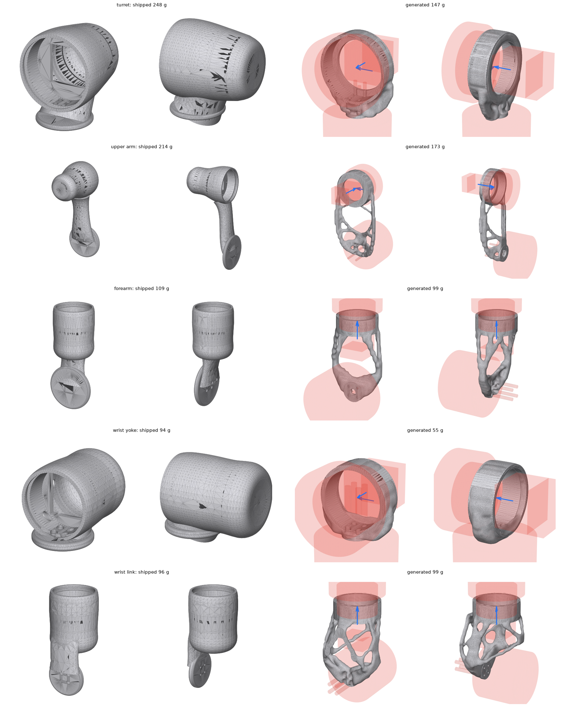

# GRIP, redesigned generatively

Every structural link of the arm, grown from its joint layout by
loadpath, an open-source topology optimization engine for printed parts
(being split out of the Materialize repo; it will install with `pip install loadpath`) and sized together as one chain.



## What it does

`chain.py` reads the joint layout from `cad/grip_cad/params.py`. For each link it
writes a loadpath study with only the parts of the link that are not negotiable:

- **Preserved:** a bolt ring on the output flange of the joint below, and a socket
  for the drive of the joint above. The socket is a 5 mm sleeve round the housing
  plus the ledge its six M3 inserts sit in.
- **Kept out:** the drives, the motors and their CAN driver boards, the hex-driver
  access to every hub bolt, and room for the next link to swing.

Everything between the hub and the socket is the optimizer's.

Loads come from statics over `urdf/grip.urdf`. Each link carries everything past
it: the links, drives, gripper and a 1 kg payload, with the arm reaching out
horizontally and a 1.5x dynamic factor. Each link also sees the joint above
at its rated torque (the URDF effort), plus a 20 N push along that joint's axis.

The goal is a safety factor of 2 in SLS PA12-GF, as light as possible. After a
pass, the new link masses go back into the statics and the links are optimized
again.

```bash
pip install loadpath            # or put materialize/cad-runner on PYTHONPATH
python generative/chain.py studies                 # write studies/*.json
python generative/chain.py run --iterations 2      # optimize every link, feed masses back
python generative/chain.py report                  # shipped vs generated, same loads
```

## Results (two iterations)

Every part below was verified by a fresh FEA of the delivered mesh under the same
three load cases. Deflection is in mm at the joint above. SF is against 48 MPa,
with a 1.15 allowance.

| Link | Shipped | Generated | SF shipped → generated | Reach deflection | Rated-torque deflection | Side-push deflection |
| --- | --- | --- | --- | --- | --- | --- |
| Turret | 248 g | **147 g** | 1.37 → 1.44 | 0.82 → 0.73 | 0.93 → 0.82 | 0.25 → 0.09 |
| Upper arm | 214 g | **173 g** | 0.50 → 3.89 | 2.69 → 0.70 | 2.05 → 0.25 | 4.42 → 1.35 |
| Forearm | 109 g | **99 g** | 0.51 → 4.09 | 1.81 → 0.21 | 0.14 → 0.05 | 0.39 → 0.03 |
| Wrist yoke | 94 g | **55 g** | 2.33 → 2.73 | 0.50 → 0.32 | 0.25 → 0.16 | 0.03 → 0.03 |
| Wrist link | 96 g | 99 g | 0.48 → 3.42 | 0.75 → 0.17 | 0.95 → 0.11 | 0.94 → 0.16 |
| **Total** | **761 g** | **572 g (−25%)** | | | | |

Every generated link is stiffer than the shipped one in every load case, and
four of the five are lighter. The upper arm, forearm and wrist link go from
breaking at their joint's rated torque (SF ≈ 0.5) to safety factors of 3.4–4.1.

## What it does not change, yet

- **Joint torques barely move.** At J2 the static torque goes from 14.7 to
  14.5 N·m, because the printed links are a small share of what J2 carries:
  about 2.1 kg of motors, gearboxes, bearings and gripper, against about 0.5 kg
  of printed links past J2. Lighter links alone will not let J2 step down from the NEMA 23. That
  takes moving mass out of the wrist, for example by driving J4–J6 from the
  forearm or elbow through belts or cables. That is the next study: the
  structure is no longer the constraint.
- **The motor pods are gone.** The shipped links enclose each motor and
  driver; the generated ones only carry them. Covers would need to be added
  back as thin non-structural shells, about 10–20 g a link, if the
  protection or look matters.
- **Resolution.** These ran at about 3 mm voxels, so members are at least
  about 4.5 mm. Finer runs should take more off. The turret's safety factor
  of 1.44 is under the goal of 2 in the finer verification; the study's own
  check passed it at its resolution.
- **Assumptions to check against the real assembly:** the bolt ring size,
  the 5 mm socket sleeve, the swing clearances and the cable run. FDM parts
  would need a run with PETG and the build direction set.

Generated with loadpath's eval harness; the studies in `studies/` are plain JSON
and can be re-run or edited by hand or by an agent.
