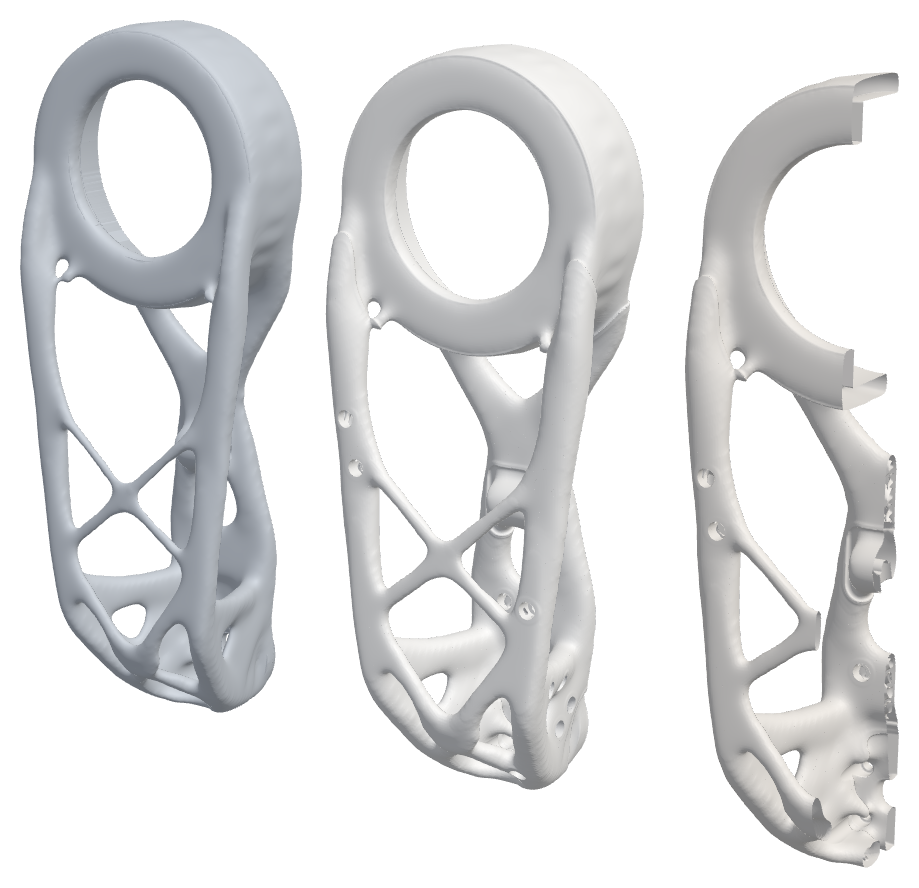
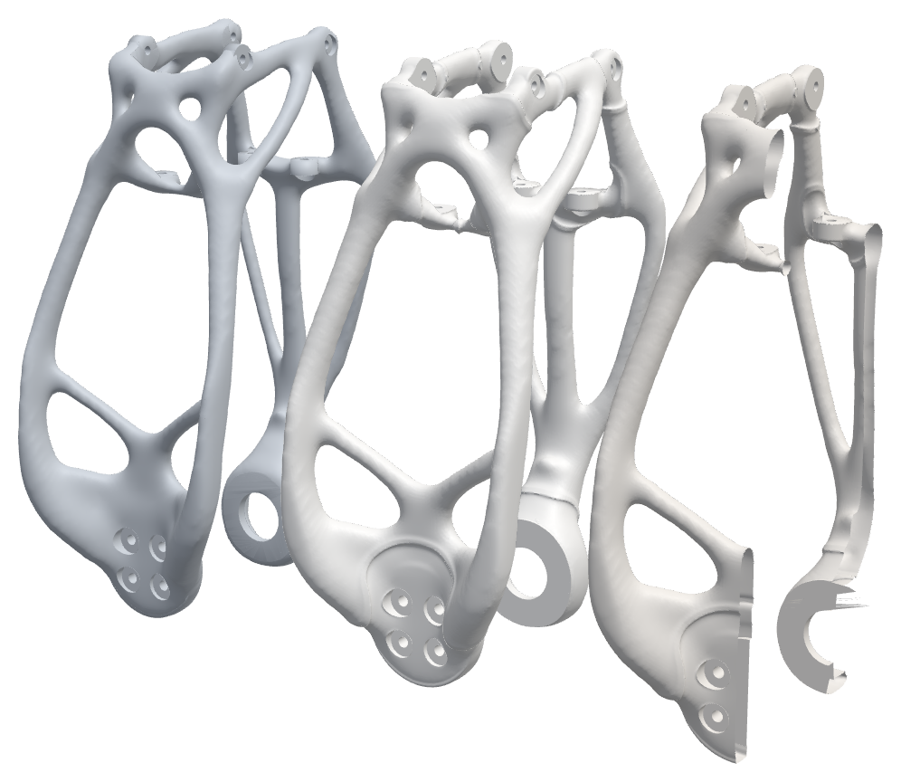

# GRIP, SLS edition

A second build of the generative GRIP arm for powder-bed nylon (SLS PA12). Where it pays, a link is
hollow: a smooth skin over a gyroid core, which only a powder process can print, since nothing inside
needs support and the powder drains through holes placed where the stress is lowest. Where hollowing
does not pay, the link is the same as the generative v0.3 part. Every interface (hubs, sockets, bolt
holes, servo pockets) is unchanged, so each SLS link swaps in for its v0.3 counterpart one for one.

Built with [loadpath](https://github.com/connorwhite-online/loadpath) `examples/grip/sls.py`.

| Upper arm | Wrist link |
| --- | --- |
|  |  |

Each image shows, left to right, the solid part the link is built from, the hollow link, and the hollow link cut open.

## Parts (`parts/`, 3MF, mm, arm home pose; palm in the hand frame)

| File | Qty | Process / material | Mass (PA12) | Notes |
| --- | --- | --- | --- | --- |
| upper_arm.3mf | 1 | SLS PA12 | 189.2 g | hollow, gyroid core, 6 mm drain holes |
| wrist_link.3mf | 1 | SLS PA12 | 43.7 g | hollow, gyroid core, 6 mm drain holes |
| base.3mf | 1 | SLS PA12 or PA12-GF | | v0.3 |
| turret.3mf | 1 | SLS PA12-GF | | v0.3 |
| forearm.3mf | 1 | SLS PA12-GF | | v0.3 (a hollow forearm was heavier and weaker) |
| wrist_yoke.3mf | 1 | SLS PA12-GF | | v0.3 |
| palm.3mf | 1 | SLS PA12-GF | | v0.3 |
| finger.3mf | 3 | SLS TPU 88A-95A | | v0.3 |
| nail.3mf | 3 | SLS PA12-GF | | v0.3 |

Hardware, drives and servos are the same as the v0.3 build: J1-J3 cycloidal drives on NEMA 17,
Feetech STS3215 at J4 and J6, STS3250 at J5, an STS3215 gripper servo, and the J2 counterbalance spring.

Ordering note: the hollow links must be printed with the drain holes open, and the powder blown or
rinsed out through them. Ask the print service to depowder the internal cavities.

## Checks (plain PA12, loads derived from the arm's URDF)

| Link | Mass | Voxel SF | Tet SF | v0.3 on the same checks |
| --- | --- | --- | --- | --- |
| Upper arm, hollow | 189.2 g | 3.30 | 2.88 | 184.5 g, 1.81 / 1.66 |
| Wrist link, hollow | 43.7 g | 1.87 | 4.59 | 43.3 g, 3.39 / 1.63 |

"Tet SF" is loadpath's tetrahedral cross-check, and "voxel SF" is the study's 150k-cell check. On the
wrist link, the voxel check flags the corner of the J6 servo pocket. The solid part it was built from
reads the same spot (2.16), and the tet check does not. The tet elements are coarser than the thinnest
inner walls, so the tet check reads the hub peaks well and the gyroid core only roughly.

Assembly clearance (`build/assembly_clearance.json`): each hollow link was swept against its neighbours
over their joints' URDF ranges with 1 mm clearance, and the overlap is 0 mm³.

## Rebuilding

`build/<link>/` has the field graph (`graph.json`), the study with the derived loads (`study.json`),
the solid part it starts from (`v3.stl`: the v0.3 link regrown with loadpath's stem smoothing, so the
stems carry no voxel-staircase bumps), and the reports.

```bash
loadpath field build/upper_arm/graph.json --out out/upper_arm      # mesh, drill drains, check
loadpath tune  build/upper_arm/graph.json --out tune/upper_arm     # re-tune skin, core and swell (hours)
```
